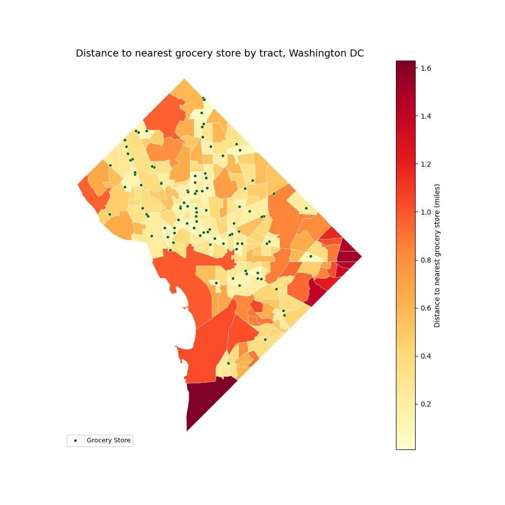
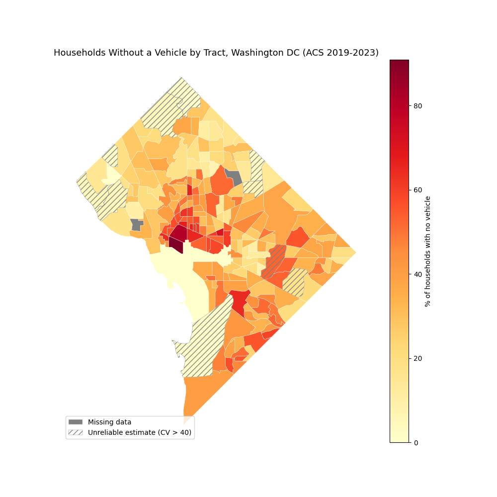

### Tracts at Risk of Poor Food Access, Washington DC

<iframe src="dc_food_access_interactive.html"
        width="100%" height="750"
        style="border:none;"
        title="Interactive map of food access risk in Washington DC"></iframe>

*Dark red tracts are at risk: more than 0.5 miles from the nearest grocery store and more than 35% of households without a vehicle. Beige tracts are not at risk. Green dots are grocery stores. Click a tract for more details.*
