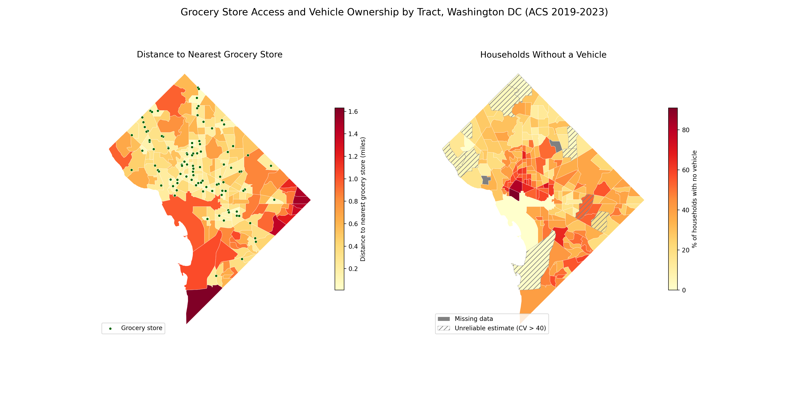

# Alexander Cohen | Command Line GIS Fall 2026
## Grocery Store Access in Washington, D.C.

For this project my data came from 3 sources: the American Community Survey 2023, Census TIGER/Line shapefiles, and Open Data DC. DC maintains extensive public data records, including spatial datasets for a wide array of issues, including grocery store locations. This dataset was originally published in June 2012, but has been regularly updated since, with the latest update being in October, 2026. The dataset is maintained by the Office of the Chief Technology Officer (OCTO). This dataset was provided in GeoJSON format via the Open Data DC website. No cleaning or joins were needed to make this data mappable. For the ACS data I performed some cleaning to ensure null, missing, and unreliable values were handled properly. To calculate the distance for each tract from its nearest grocery store I performed a spatial join between the grocery store points and the tract polygons. Using “sjoin_nearest” I was able to get the distance in feet from each tracts centroid to its nearest store, and then symbolize that as a choropleth map. I acknowledge that using centroids to calculate distance from a tract is imprecise, at best, but it seemed the most straightforward approach for the purposes of this assignment.

### Tracts at Risk of Poor Food Access, Washington DC

<iframe src="dc_food_access_interactive.html"
        width="100%" height="750"
        style="border:none;"
        title="Interactive map of food access risk in Washington DC"></iframe>

*Dark red tracts are at risk: more than 0.5 miles from the nearest grocery store and more than 35% of households without a vehicle. Beige tracts are not at risk. Green dots are grocery stores. Click a tract for more details. Distances are based on tract centroids.*
